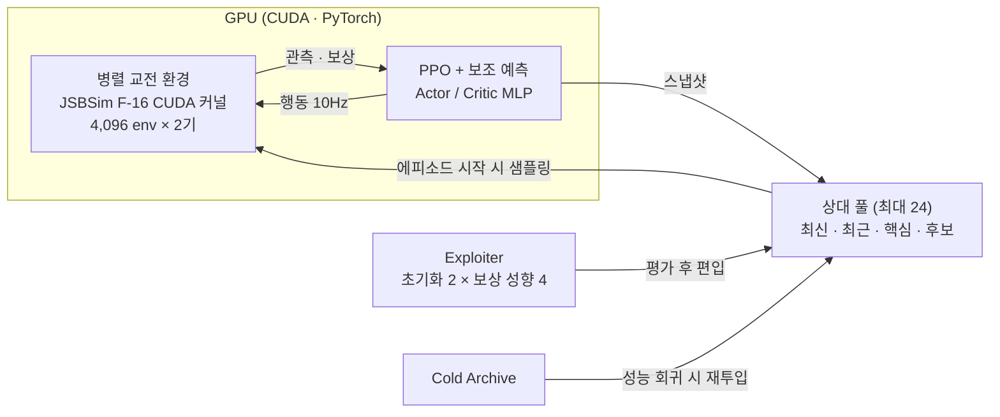

<div align="center">

# AI Pilot — GPU League Self-Play for Air Combat

**🏆 제1회 한국항공대학교 총장배 2026 AI Pilot Top Gun Challenge 1위**

팀 **추락도락이다** · 신준화 · 신지환 · 이규연 · 이태민 · 전다함


</div>

F-16 1:1 공중전(3-9 · Head-on)을 위한 강화학습 파일럿입니다.
JSBSim F-16 비행동역학을 **CUDA로 재구현**해 수천 개의 교전을 GPU에서 동시에 돌리고,
그 위에서 **PPO + 리그 자기대전 + Exploiter**로 정책을 학습했습니다.
학습된 정책은 CPU 추론 실행파일로 패키징해 대회 서버에 제출했습니다.

## Highlights

| | 내용 |
|---|---|
| ⚡ **CUDA 비행동역학** | JSBSim F-16(공력 계수 40개 · FCS · F100 엔진 · WGS84)을 host/device 공용 C로 이식. 6초 기동에서 원본 대비 위치 오차 **0.036 ft**, RTX 3070 Ti에서 **4,800만 env-step/s** |
| 🔥 **GPU 상주 학습 루프** | 관측·보상·종료·자동 리셋을 NVRTC 커널로 융합하고 rollout·GAE·PPO 갱신을 모두 GPU 텐서로 처리. 같은 학습 작업 **180초 → 2초 (약 90배)**, 누적 시뮬레이션 약 **82.5년** |
| 🧠 **정책 구조** | 독립 Actor/Critic Tanh MLP, 4채널 × 21-bin 이산 행동, 상대 0.5초 · 자기 1초 후 위치를 예측하는 **보조 학습 head** (추론 시 제거) |
| 🏟️ **리그 자기대전** | 최대 24개 상대 풀(최신 1 · 최근 4 · 핵심 16 · 신규 후보 3). 진영 교환 평가와 95% 신뢰구간, payoff 행렬의 **Nash 비중**으로 핵심 상대 선발, 보관 정책 재대전으로 성능 회귀 점검 |
| 🎯 **Exploiter** | 초기화 2종(현재 Main 복제 / 상성이 다른 보관 정책) × 보상 성향 4종(균형 · 공격 · 방어 · 추락유도). 500 iteration마다 학습 · 평가 후 상대 풀에 편입 |
| 📦 **제출 · 평가** | 10Hz 판단 / 60Hz 응답 CPU 추론, UDP 통신, PyInstaller 단일 EXE. GPU 리그전과 대회 DLL 기반 CPU 교차 평가 |

## 학습 구조



## 최종 제출 모델

| 시나리오 | 모델 | 구성 |
|---|---|---|
| **3-9** (Main) | 36,500 iteration | 184D 관측 · Actor/Critic MLP 384×3 · 4,096 env · 최종 rollout 104 / LR 5e-5 / entropy 1e-4 / γ 0.997 |
| **Head-on** | 46,500 iteration | 214D 관측 계열 · 10Hz 판단 |

제출 ZIP과 서버 배포물은 [Releases](https://github.com/gyuLee21/2026_AI_Pilot_Challenge-1st_Solution/releases)에서 받을 수 있습니다.

| 파일 | 내용 |
|---|---|
| `APTGC2026_1st_main.zip` | 3-9 제출 실행파일 (36.5k) |
| `APTGC2026_1st_headon.zip` | Head-on 제출 실행파일 (46.5k) |
| `BattleServer_V1.2_VeryLow.zip` | 로컬 대전용 서버 |

가중치와 학습 로그는 저장소에 포함하지 않습니다.

## 빠른 시작

```powershell
python -m venv .venv
.venv\Scripts\Activate.ps1
python -m pip install -r requirements.txt

# 대회 DLL 해시 검증 (DLL을 로드하지 않음)
python scripts/prepare_runtime.py

# GPU · 가중치 없이 실행되는 기본 테스트
python -m unittest discover -s tests -p "test_*runtime*.py" -v
```

학습 명령은 `--dry-run`으로 먼저 확인할 수 있습니다.

```powershell
# 최종 3-9 계보 (184D)
python scripts/train.py --runtime competition36500 --scenario three_nine --run-name my_run `
  --config configs/training/competition36500.example.json --dry-run

# 기본 214D 계보 (Head-on 등)
python scripts/train.py --scenario headon --run-name my_headon --dry-run -- --iters 20000 --rollout 64
```

GPU 학습에는 NVIDIA 드라이버와 CUDA PyTorch(NVRTC 포함)가 필요합니다.
자세한 내용은 [설치 · 실행 가이드](docs/REPRODUCIBILITY.md)를 참고하세요.

## 저장소 구성

```text
cuda_fdm/                   CUDA 비행동역학 · GPU 환경 · PPO · 리그 (214D 계보)
research/competition_36500/ 최종 3-9 36.5k 학습 소스 (184D 계보)
claude_code/                정책 네트워크 · 관측/보상 정의
controllers/mpc/            CEM 기반 MPC + C++ reduced-order 예측기
controllers/bt/             대회 SDK용 커스텀 Behavior Tree 노드
src/dogfight/               공통 상태 · 행동 규약, UDP 인터페이스
evaluation/                 GPU 리그전 · CPU 교차 평가 · 회귀 테스트
submission/                 CPU 추론 · 통신 · EXE 빌드
third_party/                대회 제공 런타임 (출처 분리 보관)
scripts/ configs/ tests/    실행기 · 설정 예시 · 테스트
```

두 학습 계보(214D / 184D)는 관측 · 커널 · 체크포인트 규약이 달라 서로 섞지 않습니다.
`scripts/train.py --runtime`으로 명시적으로 선택합니다.

## 문서

| 문서 | 내용 |
|---|---|
| [cuda_fdm/README.md](cuda_fdm/README.md) | CUDA 포팅 방식, 검증 정확도, 성능 측정 |
| [cuda_fdm/FUTURE_AUXILIARY.md](cuda_fdm/FUTURE_AUXILIARY.md) | 미래 위치 보조 학습 설계 |
| [research/competition_36500](research/competition_36500/README.md) | 최종 3-9 학습 계보와 설정 |
| [evaluation/README.md](evaluation/README.md) | 평가 프로토콜 |
| [controllers/mpc](controllers/mpc/README.md) · [controllers/bt](controllers/bt/README.md) | 제어기 |
| [submission/README.md](submission/README.md) | 제출 패키징 |
| [docs/STRUCTURE.md](docs/STRUCTURE.md) | 코드 · 모델 저장 구조 |
| [docs/PROVENANCE.md](docs/PROVENANCE.md) | 출처와 권리 |

## 출처와 라이선스

대회 제공 DLL과 F-16 모델 데이터 등 외부 자료는 [`third_party/`](third_party/competition_runtime/README.md)에
원본 그대로 분리 보관하며, 원 권리자의 조건을 따릅니다 ([NOTICE](third_party/competition_runtime/NOTICE.md)).
JSBSim 기반 코드와 모델 데이터의 기존 저작권 표시는 유지합니다.
이 저장소에는 별도의 오픈소스 라이선스를 지정하지 않았습니다.
